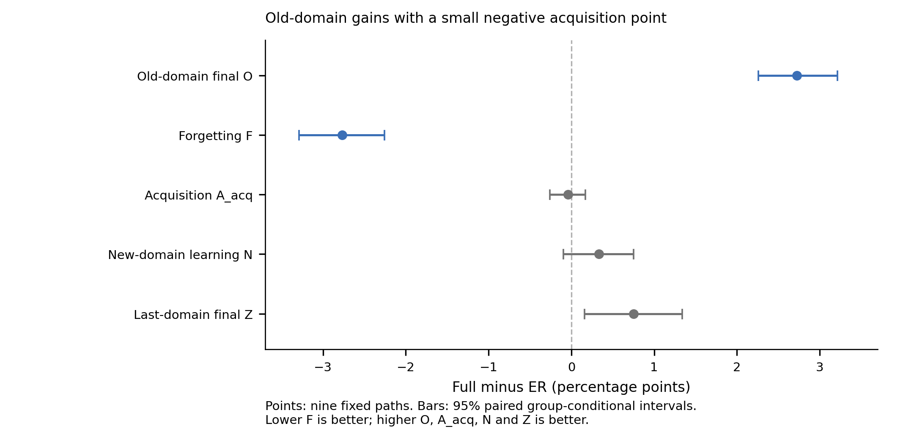
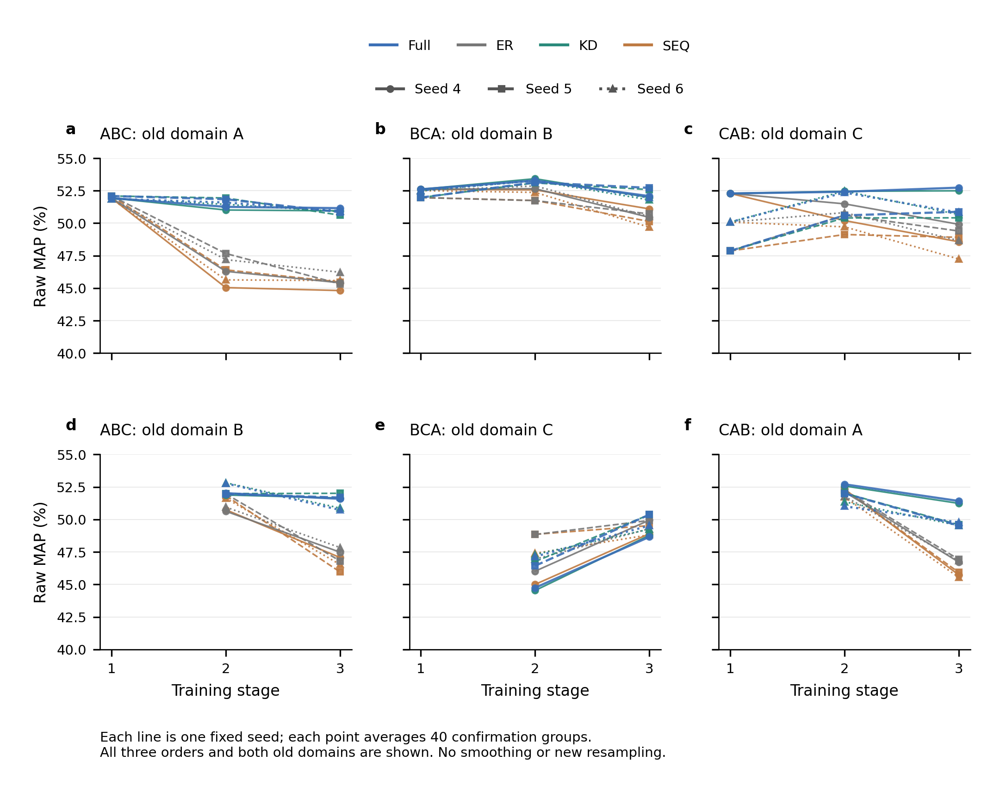

# 中文H主实验消融：完整结果与组件作用

2026-11-16。本文为主执行者基于完整保存结果的独立分析，结果网页外审尚未完成。原始指标、原判据和失败记录保持；本次没有重训、重新生成确认群、载模重评分或重新bootstrap。

**本次结果提供了明确、可重复的旧域保持正向证据，尤其支持出生评分保持项；预定Full−ER联合验收仍为false，唯一未过项是平均取得能力A_acq的点值非负保护。**差值只有−0.0414pp，条件区间跨零，不能据此断言有实质退化；也不能事后把零阈值删除，或直接认定它必然来自随机波动。首域R11并未降低：Full与ER九组配对、三个分数角色、全部22指标的首域保存均值完全一致。微小负值来自第二域R22的异向变化。

## 1. 本次实验实际完成了什么

固定中文合成机制、历史权重开发选中的trial3母体、八配置、ABC/BCA/CAB×seed4/5/6。63新增轨迹完整成功，复用Full九轨迹，共72逻辑轨迹、216阶段端点；新训练54432更新，85536梯度群呈现。Full复用不等于零训练成本，母体费用仍在原账。

同一新确认120群，每实际域40群；72×6阶段格×40群=17280群前向，432格、raw/stage-cal/first-cal共1296套指标完整。每套40群、22指标；三角色共享原raw前向，不是三倍独立样本。完整盲分数于15:05:36.583写出，程序随后于15:05:36.587执行唯一`ablation_confirmation_joint`，只开放既定pairs；owners仍封存。评分与分析分别成功、释放，15:06:16监管闭合，无本次新运行失败。

原50科学来源逐项大小/SHA一致；恢复只处理无上限辅助deadline的JSON元数据，原生成退出1及费用保留，接受原120群产物而没有再生成。后处理09:59:13—15:06:16，实际约5小时7分03秒。Linux既有py310执行正式评价和本次保存字段整理；独立核对28512项群指标到阶段均值、33264项阶段到轨迹公式全部一致，见[核对记录](check.json)。Windows仅做具名传输、文件大小/SHA及编辑。

完整原件由[source_manifest.json](source_manifest.json)绑定：1319份、26607489字节，已SFTP回传并逐项核对。包括[原summary](summary.json)、[确认结果](confirmation_result.json)、1296份群指标、阶段/监管回执、访问记录、成本及费用。正文、pairs/owners载荷、预测矩阵、Memory和权重没有回传。[完整22指标表](tables.zh.md)、[分层与核对明细](analysis_details.json)从保存值生成。

## 2. 八配置的结果全貌

下面为raw排序指标；能力用%，F用pp，负F表示相对取得水平平均提升。各值为三个seed各自先平均三顺序之后的均值±sample SD；三顺序不当作九个独立训练重复。A_acq=(R11+R22)/2，O=(R31+R32)/2，F=A_acq−O，N=(R22+R33)/2，Z=R33，final=(R31+R32+R33)/3。F不是历史最大值下降。

|配置|最终MAP|最终MRR|旧域最终O|遗忘F|取得A_acq|新学N|末域Z|
|---|---:|---:|---:|---:|---:|---:|---:|
|Full|51.5608±0.2170|56.6869±0.2329|50.9665±0.3257|−0.1896±0.4484|50.7769±0.3490|51.4178±0.2392|52.7494±0.3114|
|ER|49.4934±0.1440|54.4928±0.1958|48.2403±0.0714|2.5781±0.0943|50.8184±0.1215|51.0844±0.2227|51.9997±0.3116|
|KD|51.4909±0.2210|56.5735±0.2453|50.8693±0.3447|−0.0660±0.5027|50.8032±0.3068|51.4365±0.3114|52.7341±0.2555|
|SEQ|49.1105±0.1838|54.0553±0.1281|47.5281±0.2562|3.3060±0.2870|50.8341±0.0310|51.2380±0.3100|52.2755±0.1991|
|NoRegroup|48.8661±0.4784|54.0084±0.4651|48.6519±0.6442|1.0576±0.3847|49.7095±0.4731|48.9986±0.4329|49.2944±0.3403|
|MeanPool|50.8083±0.3261|55.8563±0.3555|50.2567±0.2427|−0.3926±0.3839|49.8641±0.6050|50.4014±0.6364|51.9114±0.5416|
|StandardRank|51.2956±0.3224|56.3654±0.4005|50.6486±0.3824|−0.5473±0.1532|50.1013±0.4516|51.0652±0.5394|52.5898±0.2129|
|AccountPool|50.6050±0.4206|55.7588±0.4555|49.9524±0.3839|0.6788±0.6520|50.6311±0.5268|50.7171±0.6920|51.9103±0.5509|

Full最终MAP在这八个固定配置中最高，但“所有组件都通过更少遗忘起作用”不成立。KD已经接近Full；MeanPool和StandardRank的F更负，但它们取得能力和最终能力都更低，直接说明单看F会误判。

## 3. Full−ER主门与微小初学差异

差值均为Full−ER，单位pp。区间是原5000次实际域分层、共享群索引的paired cluster bootstrap，条件于固定九条路径、选定母体和合成机制。

|预定项|配对差|95%条件区间|原要求|实际判断|
|---|---:|---:|---|---|
|旧域最终O|+2.7262|[+2.2572,+3.2150]|区间下界>0|通过|
|遗忘F|−2.7676|[−3.2883,−2.2583]|区间上界<0|通过|
|取得A_acq|−0.0414|[−0.2588,+0.1703]|均值点值≥0|未通过|
|新学N|+0.3335|[−0.0966,+0.7537]|均值点值≥0|通过|
|末域Z|+0.7498|[+0.1572,+1.3419]|均值点值≥0|通过|

最终MAP差+2.0674pp，条件区间[+1.7147,+2.4274]pp。O提高和F减少在九个顺序×seed配对全部同向；三个seed平均、三个顺序平均也全部同向。N为6/9配对提高，Z为8/9提高，因此不能把均值保护写成所有路径都无代价。

|seed（先平均三顺序）|ΔO|ΔF|ΔA_acq|ΔN|ΔZ|
|---|---:|---:|---:|---:|---:|
|4|+2.9524|−2.8366|+0.1157|+0.2499|+0.2683|
|5|+2.8223|−3.2697|−0.4474|+0.2760|+1.4469|
|6|+2.4040|−2.1966|+0.2075|+0.4745|+0.5341|

R11在九配对全部相同；R22平均差−0.0828pp，减半后构成A_acq的−0.0414pp。第二域九组4正5负，顺序ABC平均提高1.0647pp，BCA降低1.1631pp，CAB降低0.1501pp；例如BCA_s5的R22差−2.4068pp，不能把微小总平均写成每个局部差异都微小。总体A_acq区间跨零支持“没有明确平均退化证据”，不支持“已证明没有退化”“已证明等效/非劣”，也没有识别造成差异的唯一原因。这里的区间不覆盖训练seed总体不确定性。

代数上，2.7676pp的F减少中，2.7262pp来自旧域最终能力提高，0.0414pp伴随取得均值微降，约98.5%/1.5%；这是恒等式分解，不是因果归因。与之前英文应用线“较弱取得和较低旧末态同时存在”的情形不同，本次少忘主要伴随更好的旧末态。

因此可以写：**固定中文合成条件下，完整H相对ER显著改善两个旧域的平均最终排序与保持，取得平均差接近零且区间跨零；预定零容差点值保护略未通过，完整联合主张没有正式通过。**不把“实验有效”“机制正向证据”“预定联合验收”混成一个成功标签，也不因这一项微负否定其余正向证据。当前不改门、不追加候选或重采样以翻转裁决。

## 4. 各组件实际支持什么

下面只使用预定消融；除Full−ER之外均为探索性区间，未作全比较家族校正。所有非删除项沿母体超参数，不代表各方法家族各自调优后的比较。

|比较|ΔO及95%条件区间(pp)|ΔF及95%条件区间(pp)|主要含义|
|---|---|---|---|
|Full−ER|+2.7262 [2.2572,3.2150]|−2.7676 [−3.2883,−2.2583]|出生评分保持在已有历史监督上的主要增益|
|KD−SEQ|+3.3412 [2.8518,3.8599]|−3.3720 [−3.9180,−2.8530]|无历史监督时，出生保持也有明显保持增益|
|ER−SEQ|+0.7122 [0.4792,0.9587]|−0.7279 [−0.9902,−0.4743]|历史监督单独有益，但幅度小于保持分支|
|Full−KD|+0.0972 [0.0050,0.1880]|−0.1235 [−0.2284,−0.0195]|已有保持分支后，历史监督的额外增益很小|
|Full−SEQ|+3.4384 [2.9587,3.9580]|−3.4956 [−4.0305,−2.9786]|完整历史策略相对顺序学习有明确旧域改善|
|Full−NoRegroup|+2.3146 [1.6515,3.0119]|−1.2472 [−1.8146,−0.6864]|重组兼有取得、保持及新学收益|
|Full−MeanPool|+0.7098 [0.4177,1.0034]|+0.2031 [−0.0804,0.5023]|混合池化提高能力，未显示更少遗忘|
|Full−StandardRank|+0.3179 [0.1057,0.5341]|+0.3577 [0.0907,0.6293]|当前排序目标取得/末态更好，F反而更高|
|Full−AccountPool|+1.0141 [0.6761,1.3671]|−0.8683 [−1.2020,−0.5528]|保留记录级匹配再聚合的完整策略更好|

**出生评分保持。**Full与ER保留同样的历史监督系数，差别是β保持分支；KD与SEQ提供另一侧验证。两个对照都显示较大的O/F改善，且Full−ER九配对一致。这支持出生评分保持对固定中文任务的条件贡献，但原Full−ER严格联合保护仍差一项，不宣称纯梯度机理或跨任务普遍收益。

**历史监督。**ER−SEQ有约0.71pp旧末态收益；Full−KD只有约0.10pp。后者探索性区间虽未跨零，下界仅0.0050pp，不能据此把历史监督描述为与保持分支等量的重要来源。2×2交互I=Full−ER−KD+SEQ的O为−0.6149pp [−0.8787,−0.3553]，F为+0.6044pp [+0.3212,+0.8899]，表现为保持收益的边际减弱，不能写“已证两分支协同放大”。也不由此授权删除监督分支或挑KD成为新母体。

**同控重组。**相对NoRegroup，Full的A_acq提高1.0674pp，N提高2.4193pp，Z提高3.4551pp，O提高2.3146pp、F减少1.2472pp。它兼顾学习与保持，不只是抗遗忘补丁。该变体同时改变当前/历史监督中的自然与重组平均，不能分离两处重组各自的作用；A1只在合法同控分量内重分配完整记录，不增加或删除记录。

**匹配分数混合池化。**相对完整mean替换，Full的A_acq提高0.9128pp、N提高1.0165pp、Z提高0.8380pp、O提高0.7098pp；F差+0.2031pp且区间跨零。证据支持较好的表示/匹配读出水平，不能宣称该混合池化减少遗忘，也未比较纯LogMeanExp或最优混合系数。两者保持同一FP64聚合工作精度与FP32输出。

**当前排序目标。**Full相对StandardRank的A_acq提高0.6756pp、O提高0.3179pp、最终MAP提高0.2652pp，F反而高0.3577pp。其主要作用是取得与最终能力，StandardRank更负的F部分伴随更低的取得水平。固定λ下的目标替换也改变双正例梯度/相对尺度，不能归因为单独“去除正例竞争”，更不是两种目标分别调参后的最优比较。

同次开放的单/双正例补充：Full−StandardRank最终MAP差分别约+0.3433/+0.1610pp，MRR差约+0.3433/+0.2925pp，Recall@5差约+0.1563/+0.1736pp。单正例MAP=MRR为定义性质，不算两份独立支持；不能说增益只来自双正例。完整取得/保持/新学分组表见全表，未追加分组bootstrap。

**记录级匹配结构。**AccountPool先对每账号记录均值，再做账号对匹配；Full先做记录对匹配，再汇总账号关系。Full的O/F、A_acq(+0.1458pp)、N(+0.7007pp)、Z(+0.8391pp)点值均较好。该对照同时改变计算顺序与出生教师表示（账号378分数对记录表），所以支持完整结构策略，不能说是一个池化算子的纯效应，也不能把相同参数/更新数当等FLOPs。

## 5. 顺序、域及辅助指标的边界

Full−ER的O差在ABC/BCA/CAB分别为+4.6433/+0.7488/+2.7866pp，F差−4.1110/−1.3303/−2.8616pp；方向一致、幅度不均。BCA的N平均差−0.1644pp，仍有具体顺序代价。阶段图保留首域R21：ABC首域A的SEQ/ER下降明显，Full/KD保持较好；BCA第二域C在第三阶段存在正迁移，不能把所有域都描述为同等遗忘压力。

全22指标、三个角色都已回传并列表。主排序/曲线沿raw，概率/固定0.5分类沿stage-cal；例如Full最终MRR56.6869%对ER54.4928%，阶段校准F1为22.0242%对20.0647%，Brier为0.041757对0.042823，log-loss为0.164039对0.169261。分类F1与中文群检索MAP不是同一种任务聚合；不能与VendorLink的账号宏F1数值直接并列解释。

不是每个辅助指标都逐端点提高：Full−ER在Z的Recall@10约−0.2331pp、Recall@FPR1%约−0.0694pp、specificity约−0.0481pp。主MAP末域保护通过，不能扩写成所有指标均无代价。

Precision/MCC的N/A原样保留。Full在stage-cal的2160个群次中各有2064次可定义，仅14/54格的40群全可定义；因此若按规定传播N/A，汇总precision/MCC不能填0或对定义群做nanmean。原summary逐格同时保留混淆计数及pooled precision/MCC，合并值不替代原群平均。原始矩阵和全表可审查不同角色覆盖。

## 6. 费用、文件与未完成事项

最终正式账：训练736914.537161秒、确认18404.212395秒、辅助23806.359558秒，累计约216.42小时。63成功训练732020.043375秒，既往失败/预算中断4894.493786秒保留。确认生命周期5小时6分44秒、原分析11.221571秒；后处理墙钟约5小时7分03秒。累计任务费不能当全部日历工期，Full旧费用不重复计。

新增七配置各9条的成功训练累计：SEQ约18.94h，ER30.36h，KD30.47h，NoRegroup29.72h，MeanPool33.31h，StandardRank30.09h，AccountPool30.45h。周期采样整PID显存峰值约7.50—7.53GiB，不是连续瞬时最大值；AccountPool实际并未在这批显示明显墙钟优势。确认峰值RSS3708928000字节；不同配置训练RSS及精确逐端点历史字节未在本次独立回传中另行导出，不伪填估计值。正式完整性验收已检查有历史配置六群/≤1MiB、SEQ无Memory和各自正确teacher类型；容量上限不冒充各配置相同实际字节。

本次表格/图表与文件核对费用另记结果收尾账，CPU为辅助子账，不改冻结正式终账。用户随后在另一任务明确要求核对后删除本批无用权重；16:11:42已按[清理回执](../../h_ablation_weight_cleanup/receipt.json)删除189新增正式端点及1份旧预算中断端点，共247830452432字节。Full原27端点、6706份非权重证据和β活动资产保留；该新保管决定替代此前暂留安排，未追改原完成回执中的历史MODELS_RETAINED。已删端点不能靠SHA/Git恢复，本次结果分析和审查只使用保存指标/分数，不需要重新载模；未来若另需重训须另行授权。此次修复CPU临时源码与无用传输包按精确Git恢复入口收尾，必要通过/失败原件保留。无新push许可。

下一步是审查本文对A_acq微负、组件差异和N/A的解释，而不是为0.0414pp重新搜索。已实现的β英文探针按其独立合同运行，本中文结果不替代真实市场的学习/保持联合证明。
